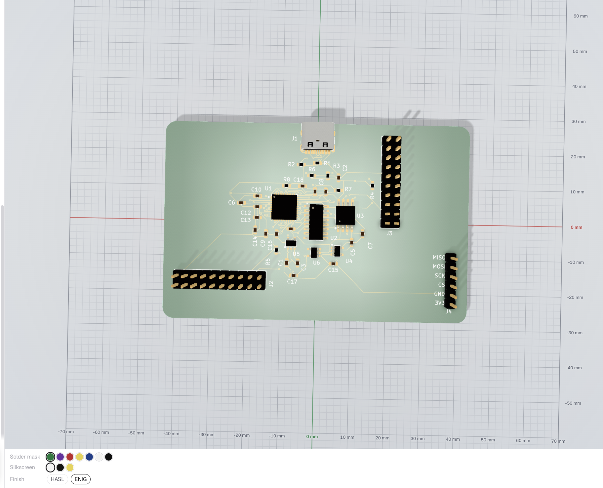

## Inky 1.0 — RV32I FPGA SoC



A compact, custom 4-layer PCB hardware platform designed to host a 32-bit RISC-V soft processor implemented from scratch in SystemVerilog.

## Project Overview

This project bridges digital design, computer architecture, and hardware engineering:
* **SystemVerilog RTL:** Design and implementation of an RV32I CPU core, ALU, register file, bus interconnect, and memory-mapped UART peripheral.
* **Hardware Platform:** Custom 4-layer PCB providing power management, FPGA configuration, serial debugging, and expansion headers.

---

## Hardware Specifications

* **FPGA (Compute Core):** Lattice `iCE40UP5K-SG48I`
* **Configuration Flash:** Winbond `W25Q32JV` (32-Mbit SPI NOR Flash)
* **USB-to-UART Bridge:** CH340C
* **Power Architecture:**
  * `3.3V` — System power & I/O (`AP2112K-3.3`)
  * `1.2V` — FPGA Core & PLL (`ME6211`)
  * `2.5V` — FPGA VPP (`ME6211`)
* **Board Dimensions:** 85 mm × 55 mm (4-layer stackup, rounded corners)
* **Expansion:** 2×10 GPIO Headers

---

## Repository Structure

```text
.
├── i-am-building-a-rv32i-fpga-soc-development-board-schematic.pdf   # Complete Board Schematic
├── i-am-building-a-rv32i-fpga-soc-development-board.step            # 3D STEP Model
├── i-am-building-a-rv32i-fpga-soc-development-board.net             # Hardware Netlist
└── README.md
